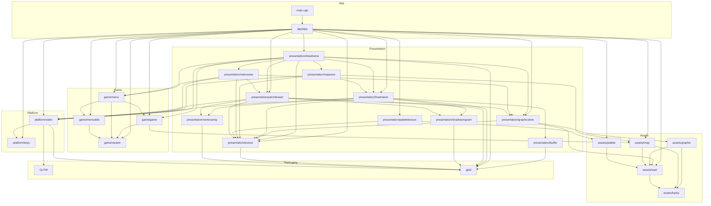

# Nillium Architecture

This file is the map of the codebase: layers, modules, owners of state, and events.
It is updated in the same commit series as the change it describes.

## Layers

Dependencies point downward only. A lower layer never calls, includes or subscribes
to a higher one. Upward information travels as return values, as state the higher
layer reads, or as a fire-and-forget event.

| # | Layer        | Folder              | Contains                                                    |
|---|--------------|---------------------|-------------------------------------------------------------|
| 5 | App          | `src/app/`, `src/main.cpp` | Main loop and wiring. The only layer that knows all others. |
| 4 | Presentation | `src/presentation/` | Renderers, HUD, menu drawing, audio playback. Reads game state, never writes it. |
| 3 | Game         | `src/game/`         | Game state, menu logic and tic-based simulation. No GL, no rendering types. |
| 2 | Assets       | `src/assets/`       | WAD access and decoded resources. Immutable after loading.  |
| 1 | Platform     | `src/platform/`     | Window, GL context and loader, input devices, audio device. |

Folders are created when the first module of that layer is added.

## Modules

| Layer        | Module                         | Responsibility |
|--------------|--------------------------------|----------------|
| App          | `main.cpp`                     | Entry point. Parses `-iwad`, creates `App` and runs it. |
| App          | `app/app.*`                    | Owns the top-level objects. Runs the main loop: poll keys, carry out menu decisions (a new game reads its first map from the WAD), run tics, draw. Detects Doom or Doom II and the episode count from the WAD. |
| Presentation | `presentation/drawframe.*`     | Decides what is drawn each frame, in `D_Display` order: the title page or the map, then the menu if open. |
| Presentation | `presentation/mapview.*`       | Draws the current map's linedefs from above, fitted into the window: walls red, openings grey. |
| Presentation | `presentation/menuview.*`      | Draws the current menu: its fixed graphics, its items and the skull cursor. |
| Presentation | `presentation/graphicstore.*`  | Owns one GPU texture per graphic name, with size and offsets. Built once from a list of names. |
| Presentation | `presentation/patchdrawer.*`   | Draws a graphic in Doom's 320x200 screen units, shown at 4:3, with its offsets and the palette. Owns the 2D shader and vertex array. |
| Presentation | `presentation/linedrawer.*`    | Draws palette-coloured lines with a scale-and-offset transform. Owns its shader, vertex array and vertex buffer. |
| Presentation | `presentation/palettetexture.*` | Builds the 256 x 14 palette texture from the decoded palettes. |
| Presentation | `presentation/texture.*`       | RAII owner of one GL texture. |
| Presentation | `presentation/shaderprogram.*` | RAII owner of one GL shader program. |
| Presentation | `presentation/vertexarray.*`   | RAII owner of one GL vertex array object. |
| Presentation | `presentation/buffer.*`        | RAII owner of one GL buffer object. |
| Game         | `game/game.*`                  | Game mode (title or level), the parameters of a new game and the current level's map. Names an episode's first map. |
| Game         | `game/menu.*`                  | Menu logic: open or closed, current menu, a cursor per menu, skull blink. Returns its decisions as a `MenuAction`. |
| Game         | `game/menudefs.*`              | Const menu tables, as in vanilla `m_menu.c`. The single source of the menu graphic names. |
| Game         | `game/variant.h`               | Doom or Doom II. |
| Assets       | `assets/wad.*`                 | Reads a WAD file once. Owns its bytes and directory. Lump lookup by name (last match wins) and by directory position. |
| Assets       | `assets/graphic.*`             | Decodes a patch lump into a `WadGraphic`: palette indices and opaque flags, row-major. |
| Assets       | `assets/palette.*`             | Decodes the 14 palettes from `PLAYPAL`. |
| Assets       | `assets/map.*`                 | Reads a map's vertexes and linedefs, finding the lumps by position after the map marker. Validates every index while reading. |
| Assets       | `assets/bytes.*`               | Reads little-endian integers as stored in WAD files. |
| Platform     | `platform/video.*`             | Initialises and terminates GLFW. Owns the window, the GL context and the window's key events. |
| Platform     | `platform/keys.h`              | Nillium's own key type. Only `video.cpp` knows GLFW key codes. |

## Dependency graph

An arrow means "includes or depends on". Every arrow points to the same layer
or a lower one; an arrow pointing upward is an architecture violation.

## State ownership

| State             | Owner (writer)            | Readers | Layer    | Flow |
|-------------------|---------------------------|---------|----------|------|
| Window + GL context | `Video`                 | App     | Platform | App calls `video.swapBuffers()` and `video.pollEvents()`. |
| Close requested   | GLFW (OS close button), behind `Video` | App | Platform | App queries `video.closeRequested()`. |
| Key input: keys pressed this frame | `Video`'s key callback, writing a private buffer only during `pollEvents()` | App | Platform | `pollEvents()` returns `std::vector<KeyEvent>` with Nillium's own `Key` type; App translates keys into `MenuInput`. |
| Quit decision     | App, local `quitChosen` in the main loop | none | App | The loop ends when the close button is pressed or the menu returns `MenuAction::Quit`. |
| Framebuffer size  | GLFW, behind `Video`      | App     | Platform | App queries `video.framebufferSize()` and passes the value to `drawFrame`. |
| Last tic run      | App, local to the main loop | none  | App      | Computed from absolute elapsed time via `std::chrono::steady_clock`. |
| WAD path          | `main`, parsed once from `-iwad` | App | App   | Passed to App's constructor as a value. Missing argument: usage, exit code 1. |
| WAD data (bytes + directory) | `Wad`, written once in its constructor | Assets functions and App, via `const Wad&` | Assets | App constructs `Wad` from the path. |
| Map data (vertexes, linedefs) | Written once by `readMap`, immutable | `Game`, `drawMap` | Assets | Returned as a value; App moves it into `Game` through `newGame()`. |
| Palettes (14, from `PLAYPAL`) | Written once by `readPalettes` | `makePaletteTexture` | Assets | Returned as a value; uploaded once as the palette texture. |
| `WadGraphic`      | Written once by `readGraphic` | `GraphicStore` constructor | Assets | Returned as a value; uploaded once as a texture per name. |
| Graphic store: per name, a GPU texture plus size and offsets | `GraphicStore`, built once from the WAD and a list of names, immutable afterwards | `drawFrame`, `drawMenu`, via `const&` | Presentation | Lookup by name; a missing name fails at construction. The names come from the menu tables and the title page. |
| Palette texture | App, built once by `makePaletteTexture`, immutable afterwards | `PatchDrawer`, `LineDrawer` | Presentation | Passed into each draw call; no drawer keeps it. |
| 2D drawing resources: shader program, vertex array | `PatchDrawer`, built once, immutable afterwards | `PatchDrawer`, when drawing | Presentation | Each `draw` sets all GL state it needs. |
| Line drawing resources: shader program, vertex array, vertex buffer | `LineDrawer`; the buffer's contents are replaced on every `draw` | `LineDrawer`, when drawing | Presentation | Each `draw` uploads all lines it is given and sets all GL state it needs, so no call depends on an earlier one. |
| Menu state: open or closed, current menu, cursor per menu, chosen episode, skull blink | `Menu`, only in `respond()` and `tic()` | `drawFrame`, `drawMenu`, via `const&` | Game | App calls `menu.respond(input, game.mode())` per key and `menu.tic()` per tic; `respond()` returns a `MenuAction`. |
| Game mode: title or level | `Game`, only in `newGame()` | App, `drawFrame` | Game | Const query `game.mode()`. |
| New game parameters: episode, skill | `Game`, only in `newGame()` | none yet | Game | App calls `game.newGame(episode, skill, map)` when the menu returns `MenuAction::NewGame`. |
| Current level's map | `Game`, only in `newGame()` | `drawFrame` via `game.map()` | Game | Const query. |
| What is drawn this frame | not stored; computed every frame | — | Presentation | `drawFrame` reads the game mode and the menu: title page or map, then the menu if open. |

## Events

None.

Rule: an event is legitimate only if nothing breaks when nobody listens.
Every event added here states that justification.

## Third-party dependencies

| Library | Version          | Source                                  | Used by                      |
|---------|------------------|-----------------------------------------|------------------------------|
| GLFW    | 3.4              | FetchContent, pinned commit             | Platform only                |
| glad    | 0.1.36, GL 4.6 core | Generated, vendored in `external/glad/` | Platform, Presentation |

- GLFW headers are included only in `platform/` source files. No public member
  function of a Platform class takes or returns a GLFW type; a forward
  declaration for a private member is allowed.

## Conventions

### Naming
- No module suffixes: `Video`, `App`, not `VideoSystem` or `AppSys`.
- One class per file pair. The file is named after the class in lowercase:
  `platform/video.h` contains `class Video`.
- Files are named by concern, not by hardware category.
- Types in `PascalCase`, functions and variables in `camelCase`,
  data members with an `m_` prefix.
- `*` and `&` bind to the type: `GLFWwindow* window`, `const Video& video`.

### Includes
- Project headers are included with the layer path and quotes:
  `#include "platform/video.h"`.
- A header from a higher layer in an include list is an architecture violation.
- Every file includes what it uses itself, instead of relying on other headers.

### Assets
- Decoders are free functions `readX(const Wad&, ...)` that return plain structs.
- Decoders validate everything while reading, so code using decoded data never re-checks it.
- Lumps that belong to a marker (map lumps) are found by position after the marker, never by name.
- Decoded assets are immutable after loading. They hold palette indices,
  never colours; the palette is applied when drawing.

### Game
- Definition tables are `constexpr` and live with the logic that uses them,
  for example `menudefs`. Presentation reads them; each name exists in one place.
- Game logic never sees keys. App translates platform keys into the Game layer's
  own input types, such as `MenuInput`.
- Decisions are returned as values, such as `MenuAction`. App carries them out.

### GPU resources
- Every GL handle is created and deleted by exactly one move-only owner.
- GL resource owners are declared after `Video` in `App`, so they are destroyed
  before the GL context.
- Shader sources are embedded in the `.cpp` of the module that uses them.
- Every draw call sets all GL state it needs; nothing relies on what an earlier
  call left bound.
- A GL resource used by several drawers is owned by App and passed into each draw call.
